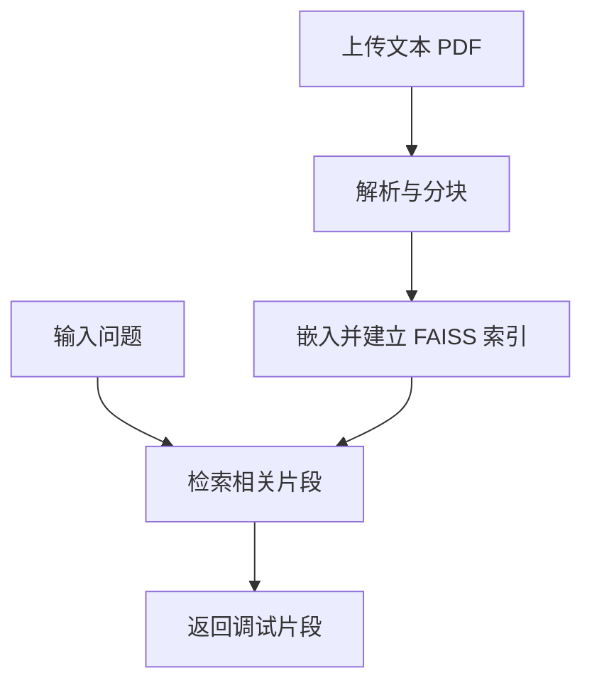

# DocMind · PDF 语义检索实验

上传 PDF、切分文本、构建向量索引，并根据问题找出相关内容。

**本地单用户调试 · Flask / LangChain / FAISS / Sentence Transformers**

[产品交互原型](https://github.com/coci-hu/docmind-prototype) · [Web 入口](app.py) · [依赖清单](requirements.txt)

## 当前能力

| 环节 | 实现 | 当前行为 |
|---|---|---|
| PDF 解析 | PyPDFLoader | 提取文本型 PDF 内容 |
| 文本切分 | RecursiveCharacterTextSplitter | 分块 500，重叠 50 |
| 向量检索 | all-MiniLM-L6-v2 + FAISS | 默认检索前 3 个相关片段 |
| Web 返回 | rag_generate.py | 返回“调试模式”及上下文前 200 个字符 |

当前 Web 路径尚未调用大模型生成回答。`USE_LLM` 标记与提示词函数的存在不代表已执行模型调用；`app.py` 也没有接入 `rag_langgraph.py`。

## 当前调用链



## 页面展示

保留原项目截图，展示当时的页面布局；实际功能以当前代码为准。


<details>
<summary>查看原产品目标架构</summary>

此图为目标设计，不表示其中所有能力已实现。


</details>

## 尝试运行

```bash
git clone https://github.com/coci-hu/rag-project.git
cd rag-project
python -m venv .venv
```

Windows PowerShell：

```powershell
.\.venv\Scripts\Activate.ps1
python -m pip install -r requirements.txt
python app.py
```

macOS / Linux：

```bash
source .venv/bin/activate
python -m pip install -r requirements.txt
python app.py
```

访问 `http://127.0.0.1:5000`，上传一份小型文本 PDF，再提问。当前预期结果是带“调试模式”的检索片段。

现有依赖清单仍需干净环境复现；以上是入口说明，不代表已通过安装测试。首次使用嵌入模型可能需要下载模型文件；当前调试返回不需要真实大模型 API 调用。

## 文件导航

| 文件 | 用途 |
|---|---|
| app.py | Flask 路由、上传与临时缓存 |
| index.html | 浏览器交互页 |
| rag_core.py | 解析、切分、索引、检索 |
| rag_generate.py | Web 使用的回答函数，当前为调试返回 |
| rag_langgraph.py、main.py | 其他实验入口，使用前单独核验 |
| requirements.txt | 当前依赖清单 |

## 使用边界

- 当前固定 `default` 缓存键使访问者共享索引，重新上传会覆盖前一索引，仅适合本地单用户调试。
- 上传文件名直接参与保存路径，需补文件名清理、路径约束、格式及大小校验。
- 内存索引随进程结束丢失，尚无用户隔离和持久化文档管理。
- OCR、答案引用、会话记忆与质量评估不能按已实现能力展示。

## 完善路线

| 顺序 | 工作 | 验收方式 |
|---|---|---|
| 1 | 整理可安装依赖 | 空虚拟环境安装，记录 Python 版本和启动结果 |
| 2 | 文件和输入校验 | 非 PDF、空内容、超大文件及空问题有明确响应 |
| 3 | 真实生成与调试模式切换 | 缺配置有提示，超时可恢复，回答有资料依据 |
| 4 | 来源片段与页码 | 引用可对应原 PDF |
| 5 | 用户与文档隔离 | 两个会话上传不同文件，检索不串数据 |
| 6 | 评估图工作流 | 固定问题集比较相关性、无依据回答率、耗时与成本 |

每次先验证一条完整链路，再扩展能力。
